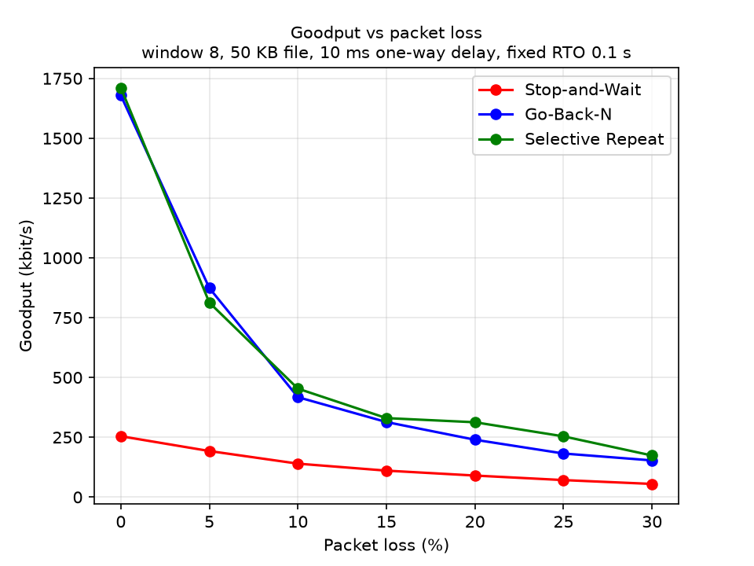
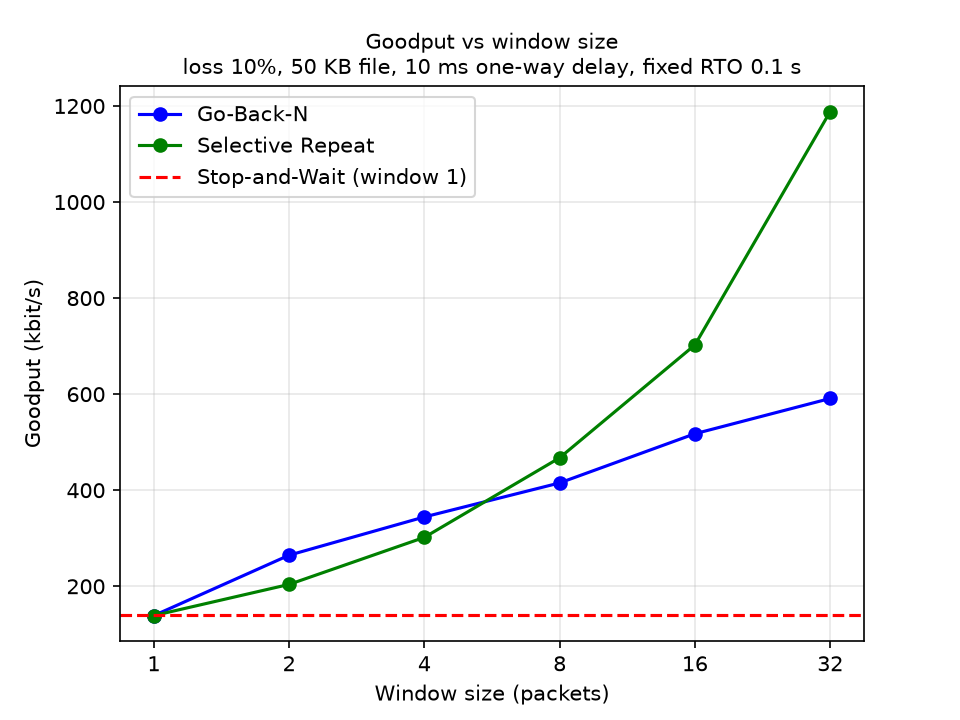
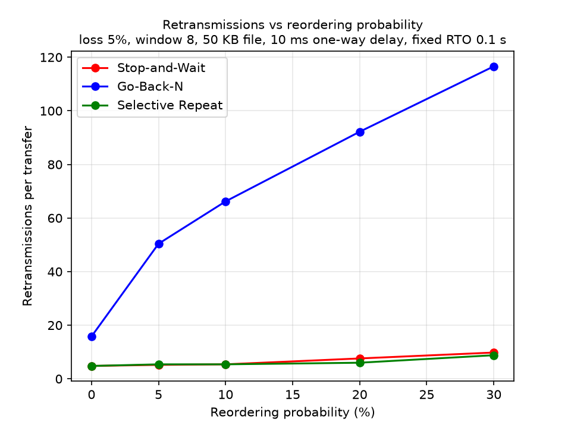

# Datagram

## Project Overview

Datagram is a Python project for reliable file transfer over UDP. UDP only sends bytes to an address; it does not promise delivery, order, uniqueness or integrity. Datagram adds those promises with sequence numbers, checksums, acknowledgements, timeouts and retransmission, using three swappable ARQ (Automatic Repeat reQuest) protocols: Stop-and-Wait, Go-Back-N and Selective Repeat. A seeded channel emulator injects loss, duplication, reordering, corruption and delay, so every protocol can be tested and compared under identical conditions. Each transfer is verified by comparing SHA-256 hashes of the source and received files.

An adaptive retransmission-timeout (RTO) estimator (Jacobson/Karels, with Karn's rule) sets the timer from measured round-trip times. Stop-and-Wait and Selective Repeat use it through `est=`; Go-Back-N currently uses a fixed timeout.

## Features

- Calculates an RTO from RTT samples using SRTT and RTTVAR.
- Supports configurable minimum and maximum RTO bounds.
- Applies exponential backoff after a timeout.
- Can use a fixed timeout that does not learn from RTT samples.
- Includes a small executable demonstration in the estimator module.
- Reliable, in-order, byte-exact file delivery over UDP using Stop-and-Wait ARQ.
- Go-Back-N ARQ with a configurable sliding window, cumulative ACKs, a single timer for the oldest unACKed packet, and whole-window retransmission on timeout. With window=1 it behaves like Stop-and-Wait.
- Receiver detects duplicates: they are re-ACKed but never written twice.
- Corrupt and truncated packets are detected by our handwritten CRC-32 and discarded.
- Seeded channel emulator (loss, corruption, duplication, reordering, delay and jitter), so every run is reproducible.
- Uniform stats from every protocol: packets_sent, retransmissions, bytes_delivered, elapsed_s.
- Adaptive RTO (Jacobson/Karels) with Karn’s rule and an optional backoff reset.
- Selective Repeat ARQ with per-packet ACKs and timers and a receiver out-of-order buffer.
- Experiment harness, sweep runner and plotting scripts (`experiments/`) that reproduce all results in `results/`.

## Project Structure

```text
Datagram/
├── tests/
│   ├── test_channel.py         # Channel: loss, corruption, reproducibility
│   ├── test_channel_v2.py      # Channel: duplication, reordering, delay, jitter (fake clock)
│   ├── test_gbn.py             # Go-Back-N tests: receiver, window, loss, seeds
│   ├── test_loopback.py        # End-to-end transfers with hash check, seed sweep
│   ├── test_packet.py          # Packet pack/unpack and handwritten CRC-32
│   ├── test_rto.py
│   ├── test_sender_timeout.py  # Sender with no receiver: retry limit and stats
│   ├── test_split.py           # Chunking edge cases
│   ├── test_timers.py
│   ├── test_sr_sender.py       # Selective Repeat sender tests
│   ├── test_sr_receiver.py     # Selective Repeat receiver tests
│   ├── test_sr_loopback.py     # Selective Repeat end-to-end transfers with hash check, seed sweep
│   └── test_transfer.py        # End-to-end transfers: 3 protocols x 4 channel conditions x 2 seeds x 6 sizes
│
├── experiments/
│   ├── harness.py        # run_trial(): runs one transfer, returns one CSV row
│   ├── run_sweeps.py     # The four experiments (loss, window, reorder, RTO)
│   └── plots.py          # Plots, RTO table, claim check, SHA-256 integrity check
│
├── results/              # CSVs and PNG plots produced by the experiments
└── datagram/
    ├── __init__.py   # Empty Python package marker
    ├── channel.py    # Channel emulator
    ├── packet.py     # Packet format, pack/unpack, handwritten CRC-32
    ├── timers.py     # Timer helpers
    ├── protocols/
    │   ├── __init__.py
    │   ├── base.py       # ARQProtocol interface
    │   ├── gbn.py        # Go-Back-N sender and receiver
    │   ├── sr.py         # Selective Repeat sender, receiver and driver
    │   └── stop_wait.py  # Stop-and-Wait sender and receiver
    └── rto.py        # RTO estimator and executable demonstration
```

This structure reflects the project files present when this README was updated. Tests are in tests/ and use pytest.

## Prerequisites

- Python 3. The repository does not declare a minimum or tested Python version.
- Git, if cloning the repository.
- pytest, only to run the tests.
- matplotlib and pandas, only to run the experiments and plots (listed in requirements.txt).

The protocol code in `datagram/` imports no third-party packages. Only the experiments use matplotlib and pandas.

## Installation

Clone the repository and enter its directory:

```bash
git clone https://github.com/SanviShan25/Datagram.git
cd Datagram
```

Install the dependencies below. matplotlib and pandas are needed only for the experiments and plots, and pytest only for the tests.

To run the tests, install pytest:

```bash
pip install -r requirements.txt
pip install pytest
```

## Build and Run

### Build Instructions (To Be Updated)

No build system or build configuration is present. The project can be run directly with Python.

Run the included demonstration from the repository root:

```bash
python3 datagram/rto.py
```

### Run the Tests

Run from the repository root. Use python -m pytest (not bare pytest) so the datagram package is importable:

```bash
python -m pytest tests -v
```

Main test files for Stop-and-Wait:

- test_split.py: chunking of an empty file (no chunks), a 2500-byte file (1024 + 1024 + 452) and a 2048-byte file (two chunks, no stray empty chunk).
- test_sender_timeout.py: with no receiver, the sender stops after exactly max_retries transmissions and raises TimeoutError.
- test_loopback.py: real sender and receiver over the Channel, across file sizes 0, 1, 2048, 2500 and 50000 bytes and several loss/corruption settings, plus a 20-seed sweep. Each transfer is checked by SHA-256 hash and byte counts, and the test also asserts that the impairments fired and caused retransmissions. The full run takes about a minute because the receiver lingers briefly after each transfer.

Main test file for Go-Back-N:

- test_gbn.py: covers the receiver (driven by hand, with no sender), the sender with a silent receiver (window limit, whole-window resend, giving up after max_retries), clean transfers including window=1 as the Stop-and-Wait case, and transfers under loss and corruption across several seeds, including lost ACKs. Run it alone with:

```bash
python -m pytest tests/test_gbn.py -v
```

Main test file for all protocols together:

- test_transfer.py: end-to-end file transfers for Stop-and-Wait, Go-Back-N and Selective Repeat over four channel conditions (clean, loss, loss + duplication + corruption, reordering + delay), two seeds and file sizes 0, 1, 1023, 1024, 1025 and 5000 bytes. Every transfer must produce a file with a matching SHA-256 hash. Run it alone with `python -m pytest tests/test_transfer.py -q` (about a minute).

Main test files for Selective Repeat:

- test_sr_sender.py and test_sr_receiver.py: the window, per-packet deadlines, burst timeouts backing off once, and the receiver's three cases (below the window, inside it, beyond it).
- test_sr_loopback.py: real transfers over the Channel with a SHA-256 match, including one lost packet leading to exactly one retransmission, lost ACKs, a lost final ACK, window sizes 1 to 16, 20% loss both ways across seeds, and loss, duplication, corruption and reordering together.

## Usage Example

Run the built-in demonstration:

```bash
python3 datagram/rto.py
```

The demonstration submits three RTT samples to `RTOEstimator`, prints the resulting estimator state, then applies and prints a timeout backoff.

The estimator can also be imported from the package:

```python
from datagram.rto import RTOEstimator

estimator = RTOEstimator()
estimator.on_rtt_sample(0.100)

print(estimator.current_rto())
estimator.on_timeout()
print(estimator.current_rto())
```

Times are represented as numeric values; the source's demonstration uses seconds.

Stop-and-Wait transfer:

```python
import socket
import threading
from datagram.channel import Channel
from datagram.protocols.stop_wait import StopAndWait

s_sock = socket.socket(socket.AF_INET, socket.SOCK_DGRAM)
r_sock = socket.socket(socket.AF_INET, socket.SOCK_DGRAM)
s_sock.bind(("127.0.0.1", 0))
r_sock.bind(("127.0.0.1", 0))

sender = StopAndWait(
    s_sock, Channel(s_sock, r_sock.getsockname(), seed=42, loss=0.2, corrupt=0.1),
    rto=0.05, max_retries=60)
receiver = StopAndWait(
    r_sock, Channel(r_sock, s_sock.getsockname(), seed=43, loss=0.2, corrupt=0.1),
    rto=0.05, max_retries=60)

t = threading.Thread(target=receiver.receive_file, args=("dst.bin",))
t.start()
stats = sender.send_file("src.bin")   # packets_sent, retransmissions, ...
t.join()
```

Note: in Stop-and-Wait and Selective Repeat the timeout comes from `est`. With no `est` it is adaptive and starts at 0.5 s. `rto=` only sets the receiver's linger time. For a fixed timeout pass `est=RTOEstimator(fixed=0.05)`.

Go-Back-N transfer (same setup as above; only the class and the keyword-only window argument change):

```python
from datagram.protocols.gbn import GoBackN

sender = GoBackN(
    s_sock, Channel(s_sock, r_sock.getsockname(), seed=42, loss=0.2, corrupt=0.1),
    window=8, rto=0.05, max_retries=60)
receiver = GoBackN(
    r_sock, Channel(r_sock, s_sock.getsockname(), seed=43, loss=0.2, corrupt=0.1),
    window=8, rto=0.05, max_retries=60)
```

Selective Repeat transfer (same setup; `window` sets the window size):

```python
from datagram.protocols.sr import SelectiveRepeat

sender = SelectiveRepeat(
    s_sock, Channel(s_sock, r_sock.getsockname(), seed=42, loss=0.2),
    window=8, rto=0.05)
receiver = SelectiveRepeat(
    r_sock, Channel(r_sock, s_sock.getsockname(), seed=43, loss=0.2),
    window=8, rto=0.05)
```

## Adaptive RTO and Karn's Rule (`rto.py`, `timers.py`)

- `RTOEstimator` turns measured round-trip times into a retransmission timeout (RFC 6298, Jacobson/Karels). The first sample sets SRTT = R and RTTVAR = R/2. After that, RTTVAR updates first and then SRTT (alpha = 1/8, beta = 1/4). RTO = SRTT + 4 x RTTVAR, clamped between `min_rto` and `max_rto`. Each timeout doubles the RTO (exponential backoff). `RTOEstimator(fixed=x)` is a fixed-timeout baseline that never learns.
- `RTTTracker` sits between a protocol and the estimator and enforces Karn's rule: no RTT sample is taken from a retransmitted packet, because its ACK is ambiguous. A protocol calls `on_send(seq, now)` on every send and resend, `on_ack(seq, now)` when an ACK arrives, and `on_timeout(seq)` when a timer fires. If several packets time out together, pass `backoff=False` for all but the first so the RTO doubles once. `discard(seq)` forgets a packet without measuring it (for cumulative ACKs).
- Optional `reset_on_retx_ack=True`: when a retransmitted packet is finally ACKed, the RTO returns to the formula value (still no sample). This is a deliberate deviation from textbook Karn. Without it, at 20-30% loss the backed-off RTO stays high and transfers slow down sharply or stall. The experiment results will quantify this.
- Currently exposed by `SelectiveRepeat`; Stop-and-Wait and Go-Back-N will expose it with the adaptive-RTO change.

## Selective Repeat (`protocols/sr.py`)

- `SRSender`: the window is `[base, base + N)`. Every packet in flight has its own deadline. ACKs are per packet, and `base` slides past consecutive ACKed packets. On timeout only the expired packets are resent, and the RTO backs off once per burst.
- `SRReceiver`, by sequence number: below the window, re-ACK it but never deliver it again. Inside the window, ACK it, buffer it if it is new, and deliver every consecutive packet starting at `rcv_base`. Beyond the window, ignore it.
- `SelectiveRepeat(sock, channel, window=8, rto=0.5, est=None, ...)` has the same `send_file` / `receive_file` interface and stats as the other protocols. The FIN is the last packet, and the receiver lingers after it to re-ACK a lost FIN ACK.

## Packet Format and ACK Semantics

All three ARQ protocols (Stop-and-Wait, Go-Back-N, Selective Repeat) share one packet format and one set of conventions. The format is implemented in `datagram/packet.py`.

### Header (15 bytes, network byte order)

| Field | Type | Meaning |
|---|---|---|
| `seq` | uint32 | Index of this packet |
| `ack` | uint32 | Which packet is being acknowledged |
| `flags` | uint8 | bit0 = `DATA`, bit1 = `ACK`, bit2 = `FIN` |
| `payload_len` | uint16 | Number of data bytes after the header |
| `checksum` | uint32 | CRC-32 (handwritten, `crc32()` in `packet.py`) over the header (checksum field zeroed) and the payload |

### Conventions

1. **Sequence numbers** count packets, not bytes, and start at 0.
2. **ACK meaning:**
   - Stop-and-Wait and Selective Repeat: `ack = N` means packet N specifically arrived.
   - Go-Back-N: `ack = N` means every packet up to and including N arrived in order (cumulative).
3. **End of file** is signalled by a final packet with the `FIN` flag and an empty payload. This also covers an empty file (zero `DATA` packets, then `FIN`).
4. **Payload size** is 1024 bytes per packet.
5. **Sending** goes through `channel.send(raw_bytes)`, including ACKs, because ACKs can be lost too. Receiving uses `sock.recvfrom(2048)`.
6. **Corrupt packets:** `Packet.unpack` returns `None` for a corrupt, truncated or padded packet. Receivers and senders ignore these.
7. **Stats:** every protocol's `send_file` and `receive_file` returns a dict with the keys `packets_sent`, `retransmissions`, `bytes_delivered` and `elapsed_s`. The experiment harness reads these by name.

### Handwritten CRC-32

The checksum is computed by our own `crc32()` in `datagram/packet.py` (IEEE 802.3 polynomial, reflected form `0xEDB88320`, table-driven with a 256-entry table built at import time). No `zlib` or other checksum library is used by the protocol code. `zlib.crc32` appears only in `tests/test_packet.py`, as a reference answer to check ours against. `pack()` builds the header with the checksum set to 0, computes the CRC over header plus payload, then writes the real value in. `unpack()` repeats the same computation and returns `None` on a mismatch.

## Channel Emulator (`datagram/channel.py`)

The `Channel` class sits between a protocol and the real UDP socket. A protocol calls `channel.send(raw_bytes)` instead of `sock.sendto(...)`, and the channel decides what happens to the packet.

| Parameter | Meaning |
|---|---|
| `loss` | Probability that a packet is dropped |
| `corrupt` | Probability that one bit is flipped (in the payload when there is one, so the checksum is what catches it) |
| `dup` | Probability that a packet is delivered twice |
| `reorder`, `reorder_delay` | Probability that a packet is held back by `reorder_delay` seconds, so later packets overtake it |
| `delay`, `jitter` | Base one-way delay and its random variation (+/- jitter seconds) |
| `seed` | Seed for the channel's own `random.Random`, so every run is reproducible |
| `clock` | Time source, injectable so tests can use a fake clock |

Design notes:

- **Reproducibility.** The channel uses its own seeded `random.Random`, never the global `random` module. For every packet it draws the same fixed set of random numbers in the same order, even if the packet is dropped. Changing one setting (for example `loss`) therefore does not change the random numbers used by the others, so experiments that vary one parameter stay comparable.
- **Delay queue.** `send()` does not sleep. It pushes each packet onto a min-heap keyed by delivery time, and `pump()` delivers every packet whose time has come. Reordering falls out of delay: a packet with a larger delay arrives after later packets. Each duplicate gets its own jitter, so a copy can overtake or trail the original.
- **`pump()`.** With `delay=0` and `reorder=0`, packets are delivered immediately inside `send()`. When delay is used, the protocol loops must call `channel.pump()` regularly, otherwise delayed packets are never delivered.
- **Stats.** `channel.stats` counts `sent`, `dropped`, `corrupted`, `duplicated` and `delivered`.
- **Tests.** `tests/test_channel.py` and `tests/test_channel_v2.py` check loss rate, reproducibility, single-bit corruption, delay, jitter bounds and reordering using a fake clock. `tests/test_transfer.py` runs complete file transfers for all three protocols over four channel conditions (clean, 20% loss, loss + duplication + corruption, reordering + delay), two seeds and six file sizes, and compares SHA-256 hashes (144 cases).

Limitations: corruption flips exactly one bit, which CRC-32 always detects, so undetected corruption is not modelled. In tests, the two directions use different seeds.

### Stop-and-Wait Design Notes

- One timer deadline per attempt. The deadline is computed once when a packet is sent, and each recvfrom only gets the time remaining. Stale ACKs and junk packets therefore cannot postpone a retransmission.
- max_retries counts total transmissions. max_retries=3 means 1 first send plus 2 retransmissions, then TimeoutError.
- Stats counting rule (sender). packets_sent counts every transmission, including retransmissions. retransmissions counts only the repeats, so first sends = packets_sent - retransmissions.
- Stats counting rule (receiver). packets_sent counts ACKs sent. retransmissions counts duplicate packets received and re-ACKed.
- Duplicate DATA. A packet with seq < expected is a duplicate caused by a lost ACK. The receiver re-ACKs it and does not write it again.
- FIN linger. After ACKing the FIN, the receiver stays up and re-ACKs repeated FINs until 10 * rto of silence has passed (the window restarts on each repeated FIN). Without this, a lost FIN ACK would leave the sender retransmitting into a closed receiver. No finite linger removes the problem entirely (the Two Generals problem); in the worst case the sender fails with TimeoutError instead of hanging or corrupting data.
- Idle timeout. The receiver raises TimeoutError if nothing valid arrives for idle_timeout seconds.
- Windows. ConnectionResetError (WinError 10054) from recvfrom is treated as "no ACK yet".
- Goodput. bytes_delivered / elapsed_s. The receiver's elapsed_s is measured up to the first ACK of the FIN, so lingering does not distort it.

### Go-Back-N Design Notes

- Constructor. GoBackN(sock, channel, *, window=8, rto=0.5, max_retries=10, idle_timeout=5.0, linger=None). Everything after channel is keyword-only.
- Sliding window. Up to window packets are in flight. base is the oldest unACKed packet and next_seq is the next packet to send for the first time. The FIN is the last packet (seq = len(chunks)) and goes through the window like any other packet.
- Cumulative ACK. ack = N means every packet up to N arrived in order. The sender accepts only base <= ack < next_seq; an older or impossible ACK is ignored.
- Receiver accepts only in-order packets. An in-order packet is written once and ACKed. An out-of-order packet or a duplicate is never written. The receiver re-ACKs the last in-order packet (expected - 1), not the duplicate's own seq. While nothing is in order yet (expected == 0), it sends no ACK.
- One timer, for base. It starts when a packet is sent into an empty window and restarts when an ACK advances base (with packets still outstanding) and after a timeout resend. Duplicate or stale ACKs, junk and corrupt packets never touch it, so they cannot postpone a retransmission.
- Timeout means "go back". The sender resends the whole outstanding window, base up to next_seq - 1, and each resent packet counts as one retransmission.
- max_retries differs from Stop-and-Wait. Here it counts consecutive timeouts without progress. It resets to 0 whenever base advances, and TimeoutError is raised when the counter reaches max_retries, before resending.
- Stats counting rule. packets_sent counts every transmission (on the receiver, every ACK sent). Sender retransmissions is one per resent packet. Receiver retransmissions counts duplicates (seq < expected) and repeated FINs.
- Linger, idle timeout and Windows handling work as in Stop-and-Wait. elapsed_s is measured before lingering.

## Experiments (`experiments/`)

The experiments test the claim from the proposal: *Selective Repeat achieves higher goodput than Go-Back-N under moderate to high loss (>5%), while both outperform Stop-and-Wait at any non-trivial window size.*

| File | Role |
|---|---|
| `experiments/harness.py` | `run_trial()` runs one transfer (protocol, seed, loss, window, reorder, file size, RTO), checks the SHA-256 hash, and returns one CSV row. `write_csv()` saves rows. |
| `experiments/run_sweeps.py` | Defines the four experiments and runs every configuration for each seed. A failed trial is recorded (`completed=False` plus the error) instead of stopping the sweep. |
| `experiments/plots.py` | Reads the CSVs and produces the plots, the RTO table, a check of the claim and a SHA-256 integrity check. |
| `results/` | Output CSVs and PNG plots. |

### Setup

All experiments use a 50,000-byte file (about 49 packets), 5 seeds per configuration (averaged), 10 ms one-way delay and one fixed RTO of 0.1 s shared by all protocols (except Experiment 4). Goodput is `bytes_delivered * 8 / elapsed_s`, in bits per second. The plots show it in kbit/s and the findings below use Mbit/s.

| Experiment | What varies | Held constant | Output |
|---|---|---|---|
| exp1 | Loss 0-30% | Window 8 | `exp1_goodput_vs_loss` |
| exp2 | Window 1, 2, 4, 8, 16, 32 | Loss 10%; Stop-and-Wait runs once as a flat baseline | `exp2_goodput_vs_window` |
| exp3 | Reordering 0-30% | Loss 5%, window 8 | `exp3_retx_vs_reorder` |
| exp4 | RTO variant (adaptive, adaptive + reset, fixed 0.05 / 0.1 / 0.3 s) at 0-30% loss | Selective Repeat, window 8 | `exp4_rto_variants`, `exp4_rto_goodput_table` |

### How to run

From the repository root. Edit `which` (`"exp1"` to `"exp4"` or `"all"`) and `quick` (`True` for a tiny test run) at the bottom of `run_sweeps.py` first:

```bash
python -m experiments.run_sweeps   # writes results/<experiment>.csv
python -m experiments.plots        # writes results/*.png, prints claim check and SHA-256 check
python -m experiments.harness      # optional: quick smoke test, writes results/smoke.csv
```

Run the sweeps before the plots, because `plots.py` reads the CSVs.

### Results





Findings (mean of 5 seeds):

- **Windowed protocols beat Stop-and-Wait.** At 0% loss, Go-Back-N and Selective Repeat reach about 1.7 Mbit/s versus about 0.25 Mbit/s for Stop-and-Wait.
- **Selective Repeat leads from 10% loss upward.** At 5% loss with window 8, Go-Back-N is slightly ahead (about 0.87 vs 0.81 Mbit/s). At 10% loss Selective Repeat is ahead (about 0.45 vs 0.42 Mbit/s), and the gap grows with loss.
- **Selective Repeat wins at larger windows.** At 10% loss, Go-Back-N is slightly ahead at windows 2 and 4 (about 0.26 vs 0.20 and 0.34 vs 0.30 Mbit/s); Selective Repeat overtakes it from window 8 upward. The gap then grows with window size.
- **The gap grows with window size.** At 10% loss with window 32, Selective Repeat reaches about 1.19 Mbit/s versus about 0.59 Mbit/s for Go-Back-N. Go-Back-N's retransmissions rise with window size (47 at window 8, 106 at window 32), while Selective Repeat's stay at 12.
- **Reordering hurts Go-Back-N most.** At 30% reordering, Go-Back-N makes about 117 retransmissions versus about 9 for Selective Repeat.
- **RTO sensitivity.** The comparison table is in `results/exp4_rto_goodput_table.csv`. Backoff-reset recovers much of the gap to fixed timeouts at high loss.

Every completed transfer is verified by SHA-256 hash, and `plots.py` reports any mismatch or failed trial.

## Known Limitations

- Go-Back-N uses a fixed timeout; it does not use the RTO estimator yet.
- Experiments run on loopback with an emulated channel, so they compare relative goodput between protocols, not absolute network performance.

## Contributors

Git commit history identifies these contributors:

- Sanvi Shan
- Shilpa Kumari
- Samridhya Mukherjee
- Akshita Singh

## Future Enhancements

- Document the supported Python version and add project/dependency metadata.
- Adaptive RTO inside Go-Back-N.
- Stretch goals: SACK blocks, sliding-window flow control, connection setup and teardown, Nagle-style coalescing.

## License

No license file or license declaration is present in the repository. The project's license is unspecified.